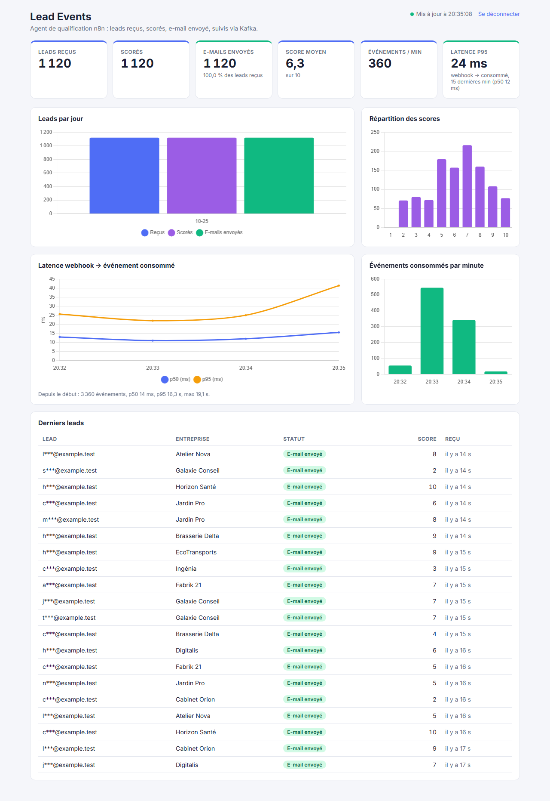

# Lead Events : un pipeline d'événements autour d'un agent n8n

[](https://github.com/samsteeven/lead-events/actions/workflows/ci.yml)

API **NestJS + Prisma (PostgreSQL)** qui reçoit, par webhook signé, les leads qu'un agent n8n qualifie, publie chaque étape dans **Kafka**, un **consumer** qui calcule les statistiques, et un **tableau de bord Vue 3**.

Le sujet vient d'un système réel : un agent n8n de qualification de leads (formulaire de contact, enrichissement de l'entreprise, score de 1 à 10, e-mail personnalisé). Ici, **tout est testé avec des leads synthétiques** (adresses en `@example.test`), jamais avec de vraies données ; le raccordement à une instance n8n est décrit dans [`docs/n8n-integration.md`](docs/n8n-integration.md) et **n'a pas été testé** contre une instance réelle.



*Le « p95 depuis le début » affiché sous le graphique de latence (16 s) inclut mon test de résistance, où le consumer était volontairement arrêté 14 s ; la tuile « Latence p95 » ne regarde que les 15 dernières minutes.*

## Architecture

```
 n8n (Lead Agent)                          ┌───────────────────── API NestJS ─────────────────────┐
   ├─ lead reçu ──┐                        │ POST /webhooks/n8n                                    │
   ├─ lead scoré ─┼─ HTTPS + HMAC ────────▶│  1. vérifie la signature (HMAC-SHA256 + horodatage)  │
   └─ e-mail ─────┘                        │  2. valide le corps (class-validator)                 │
                                           │  3. PostgreSQL : lead + clé d'idempotence (transaction)│
                                           │  4. publie dans Kafka (clé = lead)  →  202            │
                                           └───────────────────────────┬───────────────────────────┘
                                                                       ▼
                                                   Kafka : topic lead.events (3 partitions)  +  lead.events.dlq
                                                                       ▼
                                           ┌──────────────── Consumer (processus séparé) ─────────┐
                                           │ lots → processed_events (dédoublonnage) + compteurs   │
                                           └───────────────────────────┬───────────────────────────┘
                                                                       ▼
   Tableau de bord Vue 3 ◀── nginx /api ◀── API : GET /stats/*, /leads (jeton) ◀── PostgreSQL
```

| Brique | Technologie |
|---|---|
| API et consumer | NestJS 11, TypeScript, Prisma 6, kafkajs, class-validator |
| Base de données | PostgreSQL 16 |
| Bus d'événements | Kafka 3.9 (mode KRaft, sans ZooKeeper) |
| Tableau de bord | Vue 3 (Composition API), Vite, Chart.js, TypeScript |
| Tests | Jest (unitaires et intégration sur vrai PostgreSQL + Kafka), Vitest |

## Démarrer

Prérequis : Docker.

```bash
cp .env.example .env            # POSTGRES_PASSWORD, WEBHOOK_SECRET, DASHBOARD_TOKEN (valeurs de 16 caractères minimum)
docker compose up -d --build    # PostgreSQL, Kafka, migrations, API, consumer, tableau de bord
node simulator/simulate.mjs --leads 50 --realistic    # simule l'agent n8n (leads synthétiques)
```
- Tableau de bord : <http://localhost:8081> (saisir le `DASHBOARD_TOKEN` du `.env`).
- API : <http://localhost:3000> (`/health`). Tous les ports sont publiés sur `127.0.0.1` uniquement.
- Développement : `docker compose up -d postgres kafka`, puis `cd api && cp .env.example .env && npm ci && npx prisma migrate deploy && npm run start:dev` (et `npm run start:consumer:dev` pour le consumer), `cd dashboard && npm ci && npm run dev`.

## Le contrat du webhook

`POST /webhooks/n8n`, corps JSON, en-tête `x-lead-signature: t=<horodatage>,v1=<HMAC-SHA256 de "<t>.<corps brut>">`.

```json
{ "type": "lead.scored", "idempotencyKey": "<id d'exécution n8n>:lead.scored", "occurredAt": "2026-10-25T10:00:03.000Z",
  "lead": { "externalId": "42", "email": "prospect@exemple.fr", "company": "Atelier Nova" },
  "score": 8, "scoreReason": "budget confirmé et besoin urgent" }
```
| Réponse | Sens |
|---|---|
| `202` | accepté ; `duplicate: true` si cet appel avait déjà été traité (rejeu de n8n) |
| `400` | corps invalide (type inconnu, score hors de 1 à 10, e-mail invalide…) |
| `401` | signature absente, fausse, mal formée ou expirée (plus de 5 minutes) |
| `503` | Kafka indisponible : n8n réessaie |

## Décisions de conception

- **Signature HMAC avec horodatage** (comme Stripe ou GitHub) plutôt qu'un simple jeton : elle prouve que le corps n'a pas été modifié et empêche de rejouer un appel capturé. Comparaison en temps constant ; la réponse ne dit pas ce qui a échoué.
- **Idempotence à deux niveaux.** n8n peut réessayer : la clé `<exécution>:<type>` rend un rejeu sans effet côté API. Kafka livre « au moins une fois » : le consumer insère l'identifiant de chaque événement dans `processed_events` (`ON CONFLICT DO NOTHING ... RETURNING`) et n'incrémente les compteurs que pour les événements réellement nouveaux, **dans la même transaction**. Un lot rejoué ou un message livré deux fois ne change rien (testé).
- **Clé de partition = lead** : les trois événements d'un lead restent dans la même partition, donc dans l'ordre. Un événement arrivé en retard ne fait jamais reculer un lead (« e-mail envoyé » ne repasse pas à « reçu »).
- **Double écriture base / Kafka.** L'API écrit en base puis publie. Si la publication échoue, elle répond `503` et la livraison reste marquée « non publiée » : le réessai de n8n republie. Un plantage entre les deux étapes est donc rattrapé par n8n ; un *outbox transactionnel* serait plus robuste (voir les limites).
- **Consumer par lots.** Voir la section Mesures : le traitement message par message limitait le débit.
- **File morte** `lead.events.dlq` pour les messages illisibles : ils ne bloquent pas le consumer et restent analysables.
- **Les statistiques sont lues avec un jeton** et la liste des leads **masque les adresses e-mail** (`c***@exemple.fr`) : ce sont des données personnelles.
- **L'analytique ne doit pas bloquer l'agent** : côté n8n, les nœuds d'appel sont en « continue on fail » (voir le guide).
- **nginx résout le nom de l'API à chaque requête** (`resolver 127.0.0.11`). Avec un simple `proxy_pass http://api:3000`, il garde l'adresse IP du démarrage : après la recréation du conteneur de l'API (redéploiement), le tableau de bord recevait des 502. Défaut trouvé par le test navigateur, corrigé, puis vérifié en forçant un changement d'adresse (172.21.0.2 devient 172.21.0.7).

## Tests

```bash
cd api && npm test                     # 51 tests unitaires
docker compose up -d postgres kafka    # puis, avec api/.env renseigné :
cd api && npm run test:e2e             # 19 tests d'intégration sur PostgreSQL et Kafka réels
cd dashboard && npm test               # 24 tests (Vitest)
```
Les tests d'intégration utilisent un topic et un groupe de consumer propres à chaque exécution : aucun message d'une exécution précédente ne peut fausser les compteurs. Ils couvrent la sécurité du webhook (signature fausse, expirée, absente), le parcours d'un lead, le rejeu, l'arrivée dans le désordre, les doublons dans un lot, la file morte et les droits de lecture.

## Mesures

Tout tourne sur une seule machine (portable Windows, 16 threads, Docker avec 8 Go) : PostgreSQL, Kafka, l'API, le consumer et le simulateur se partagent le processeur. Les chiffres sont des ordres de grandeur, avec 3 passes par ligne (une remise à zéro des tables entre chaque passe).

**Définition de la latence.** Elle court de l'arrivée du webhook dans l'API (avant l'écriture en base et la publication dans Kafka) jusqu'à la validation de la transaction du consumer qui compte l'événement. Elle comprend donc le temps de traitement de l'API. Les deux horloges sont celles du même hôte.

### 1. Débit constant : 20 leads par seconde (60 événements par seconde)
600 leads, soit 1 800 événements, par passe ; 0 perdu, 0 doublon compté, 0 échec.

| | p50 | p95 | p99 | max |
|---|---|---|---|---|
| **Latence webhook → événement consommé** (3 passes) | 9 - 10 ms | **16 - 27 ms** | 29 - 44 ms | 49 - 83 ms |
| Réponse HTTP du webhook | 14 - 16 ms | 19 - 28 ms | | 55 - 116 ms |

### 2. Rafale : 2 000 leads (6 000 événements), 50 appels en parallèle, 5 % d'appels rejoués
Dans toutes les passes : 6 000 / 6 000 événements comptés exactement une fois (les 5 % d'appels rejoués sont reconnus comme doublons : 324 sur la première passe), 2 000 leads traités.

| Consumer | p50 | p95 | Durée totale | Passes |
|---|---|---|---|---|
| **Un message à la fois** (une transaction de 3 requêtes par message) | 9,0 - 9,8 s | **16,7 - 19,0 s** | 39 - 41 s | 3 |
| **Par lots**, une partition à la fois | 200 - 236 ms | **244 - 380 ms** | 24 - 31 s | 3 |
| Par lots, trois partitions en parallèle | 193 - 208 ms | **239 - 270 ms** | 23 - 25 s | 3 |

- Le goulot était le consumer : à 240 appels/s en entrée, il ne traitait qu'environ 150 événements/s, la file s'allongeait et la latence atteignait 9 à 19 s. Passer à un traitement **par lots** (une insertion multi-lignes dans `processed_events` qui écarte les doublons, puis des compteurs agrégés par jour et par score, en 3 requêtes quelle que soit la taille du lot) a ramené le p95 de 17 - 19 s à 0,24 - 0,38 s, soit un facteur 50 environ.
- Après la correction, la latence médiane (≈ 200 ms) est du même ordre que le temps de réponse du webhook sous 50 appels en parallèle : **c'est l'API qui limite désormais (210 à 270 appels/s sur cette machine)**, plus le consumer.
- Lire trois partitions en parallèle n'apporte pas de gain net (les plages se chevauchent) : la valeur par défaut reste 1 (`CONSUMER_CONCURRENCY`).

### 3. Résistance : consumer arrêté en pleine charge
600 leads à 20 leads/s ; le consumer est arrêté 14 s (arrêt, attente, redémarrage). Résultat : **1 800 / 1 800 événements comptés exactement une fois**, 600 leads traités ; latence p50 4,1 s, p95 17,6 s, max 19,1 s (les 14 s d'arrêt, plus le rééquilibrage du groupe Kafka et le rattrapage). Kafka conserve les messages pendant que le consumer est absent.

### Chiffres à retenir
- **Latence webhook → événement consommé : p95 de 16 - 27 ms à 60 événements/s ; p95 de 0,24 - 0,38 s en rafale de 240 appels/s.**
- **Leads traités : 600 par passe à débit constant et 2 000 en rafale, tous comptés exactement une fois, rejeux et arrêt du consumer compris.** Ce sont des leads synthétiques ; aucun vrai lead de l'agent n8n n'a été traité.

## Limites

- **Raccordement n8n non testé** sur une instance réelle ; seul le simulateur l'exerce.
- **Pas d'outbox transactionnel** : un plantage de l'API entre l'écriture en base et la publication n'est rattrapé que si n8n réessaie.
- **Pas de gestion des données personnelles** : ni effacement d'un lead, ni durée de conservation. À définir avant de brancher de vrais leads.
- **Un seul broker Kafka** et un seul PostgreSQL : pas de haute disponibilité ni de réplication ; les topics ont un facteur de réplication de 1.
- Les mesures de latence comparent deux horloges du même hôte (API et consumer) : elles ne seraient pas valables entre deux machines non synchronisées. Elles viennent d'une seule machine, avec 3 passes par ligne, et ne valent pas comme capacité de production.
- **Le consumer est resté limité à une instance** : la montée en charge horizontale (plusieurs consumers dans le groupe, jusqu'à 3 pour 3 partitions) est prévue par la conception (compteurs atomiques, `ON CONFLICT`), mais n'a pas été mesurée.
- Le tableau de bord interroge l'API toutes les 3 secondes (pas de flux temps réel) ; le jeton est stocké dans `sessionStorage`.
- Pas d'authentification par utilisateur : un seul jeton partagé.
